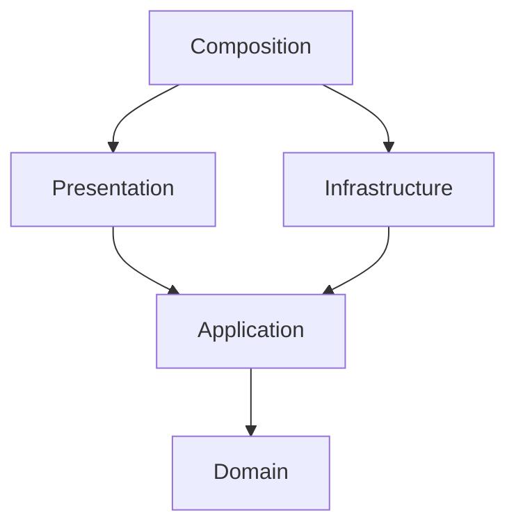

# Codebreaking context

This is a single-player deduction game: infer a hidden code from limited guesses.
The design below is the M2 contract, not implemented gameplay in M1.

| Term | Meaning and planned model |
| --- | --- |
| Code | Immutable value object: four digits, each 0 through 5; repeats allowed. |
| Guess | A candidate Code submitted by the player. |
| Feedback | Value object: exact-position matches and remaining digit-only matches. |
| Round | Aggregate and entity with an identity, secret Code, ordered guesses and state. |
| GuessScored | Immutable domain event containing the guess and Feedback, never the secret. |
| Scoring | Pure domain service comparing Code and Guess without counting a digit twice. |

A Round begins active. A correct guess wins, including on the eighth guess;
an incorrect eighth guess exhausts the Round. Terminal rounds reject further guesses.
Invalid input does not consume a turn. Example: secret 0012, guess 0203 gives
one exact and two digit-only matches. Four exact matches wins.

The **Codebreaking** bounded context owns these rules and events. Authentication,
payments, multiplayer, real cryptography and leaderboards are outside the boundary.
The hidden code is game state, not a security credential. The public response
must hide it until the Round ends. This is a local learning project.

## Dependency direction

The application owns repository ports and use cases. SQLite adapters implement
ports; HTTP adapters validate transport data with Pydantic. Only composition wires
concrete adapters. Import Linter enforces these layers, independent adapters and
the core's exclusion of FastAPI, Pydantic and Uvicorn. The core uses only the
standard library; a test imports it with site packages disabled.

## Roadmap

1. M1: vocabulary, empty layer packages, health endpoint and verification.
2. M2: Code, Feedback, Round, Scoring and GuessScored, with pure domain tests.
3. M3: start/guess/read use cases, repository port, SQLite transactions and restart tests.
4. M4: one browser screen and API to start, guess, inspect history and restart.

WASM is deferred. No rule implementations, database or playable screen ship in M1.
