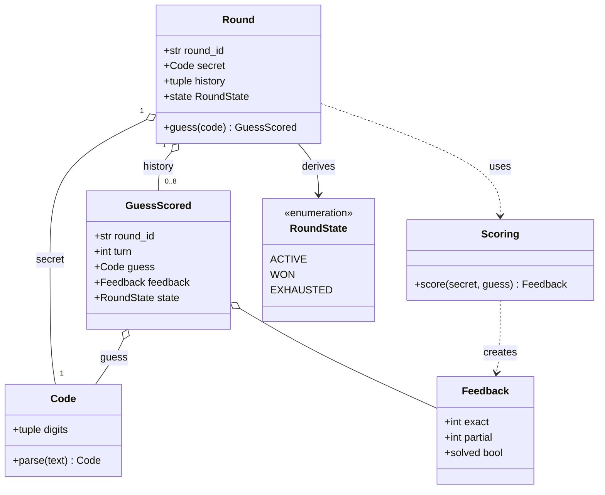
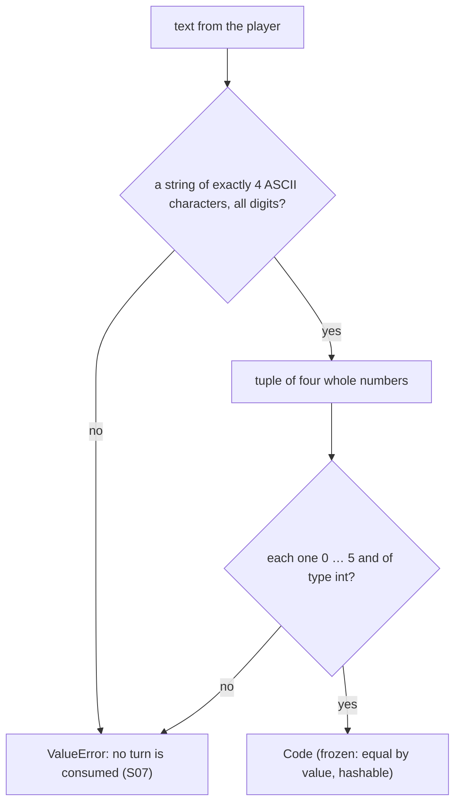
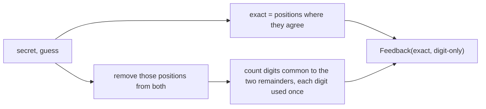
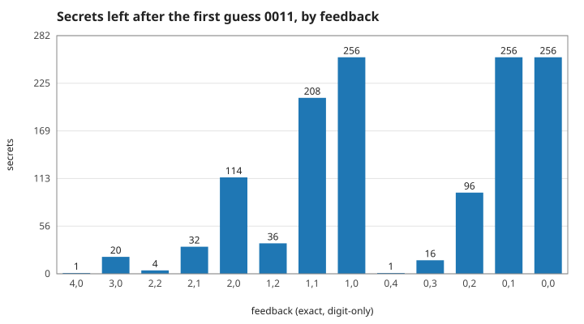
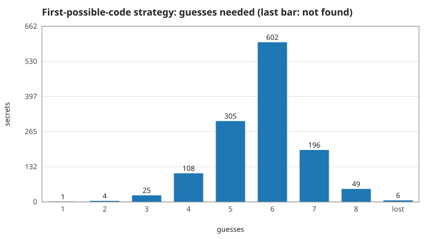
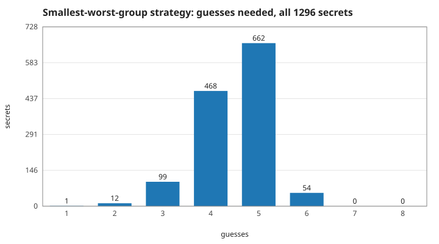

# 1. The rules: codes, feedback and what a guess tells you

The game is a deduction puzzle: a hidden code, at most eight guesses, and after each guess two numbers. Measured numbers are quoted by their id in [figures/values.md](figures/values.md).

[Back to the index](README.md)

## S01 — The language of the game

**Statement.** Six terms, each with one meaning, and nothing else is needed to state the rules:

| Term | Meaning |
|---|---|
| Code | four digits, each 0 to 5, repeats allowed |
| Guess | a Code submitted by the player |
| Feedback | two counts for a guess: exact-position matches, and remaining digit-only matches |
| Round | one game: an identity, a secret Code, the ordered guesses and a state |
| GuessScored | the record of one guess: round, turn, guess, feedback, state — never the secret |
| Scoring | the rule that turns a secret and a guess into a Feedback |

**Assumptions and where they break.** One player, one round at a time, no clock. "Secret" is game state, not a credential: it is hidden from the player, not protected from an attacker.

**Derivation.** These are definitions; the code uses the same words as class names, so that a sentence of the rules can be checked against one class.

**Code.** `src/cipher_vault/domain/model.py`: the classes `Code`, `Feedback`, `Scoring`, `GuessScored`, `Round`, `RoundState` and the exception `RoundFinished`; the constants `CODE_LENGTH` = 4 and `MAX_GUESSES` = 8.

**Tests.** `test_REQ_ROUND_a_correct_guess_wins_and_the_event_hides_the_secret` in `tests/test_domain.py` builds every one of these objects and compares them by value.

## S02 — A code: four digits from 0 to 5

**Statement.** A code is an ordered 4-tuple $c = (c_1, c_2, c_3, c_4)$ with $c_i \in \{0, 1, 2, 3, 4, 5\}$. There are $6^4 = 1296$ codes, of which $6\cdot5\cdot4\cdot3 = 360$ have four different digits. A code is a value: two codes with the same digits are equal, and a code cannot be changed after it is made.

**Assumptions and where they break.** Digits are whole numbers; `True`, `1.0` and `"1"` are not digits. Text input must be exactly four ASCII digits, so full-width digits, signs, spaces and decimal points are rejected before any digit is read.

**Derivation.** Counting with and without repetition.

**Code.** `Code.__post_init__` and `Code.parse` in `src/cipher_vault/domain/model.py`.

**Tests.** `test_REQ_CODE_four_digits_from_zero_to_five` (8 malformed tuples), `test_REQ_CODE_text_must_be_four_plain_digits` (11 malformed texts), `test_REQ_CODE_is_an_immutable_value_with_repeats`. Measured: `codes` = 1296, `codes-no-repeat` = 360, `codes-rejected` = 5 of 5.

## S03 — Scoring: exact matches first, then the rest without reuse

**Statement.** For a secret $s$ and a guess $g$, with $n_d(c)$ the number of times digit $d$ occurs in code $c$:

$$\text{exact} = \#\{i : s_i = g_i\}, \qquad \text{digit-only} = \sum_{d=0}^{5}\min\big(n_d(s),\, n_d(g)\big) - \text{exact} .$$

No position of either code is counted twice. The rule is symmetric: scoring $g$ against $s$ gives the same feedback.

**Assumptions and where they break.** Both arguments are Codes. The formula is the standard one for this family of games [Knuth 1977, §1].

**Derivation.** $\sum_d \min(n_d(s), n_d(g))$ is the size of the largest matching between the digits of the two codes regardless of position. Every exact match is one pair of that matching, and removing those pairs leaves the matches that are right in digit but wrong in place. The code computes it the other way round — remove the exact positions, then intersect the two multisets of what is left — which is the same number.

| position | 1 | 2 | 3 | 4 |
|---|---|---|---|---|
| secret | 0 | 0 | 1 | 2 |
| guess | 0 | 2 | 0 | 3 |
| exact? | yes | – | – | – |
| left in the secret | | 0 | 1 | 2 |
| left in the guess | | 2 | 0 | 3 |

Of what is left, the digits 0 and 2 occur on both sides once each: one exact, two digit-only.

**Code.** `Scoring.score` in `src/cipher_vault/domain/model.py` (two `Counter`s and their intersection).

**Tests.** `test_REQ_SCORE_exact_first_then_the_rest_without_reuse` (a hand-written table of 16 pairs, with duplicates on either side) and `test_REQ_SCORE_every_pair_agrees_with_an_independent_count`. Measured over every one of the `score-pairs` = 1 679 616 pairs: the code never differs from the formula (`score-formula` = 0) and is symmetric (`score-symmetric` = 0); the example above gives `score-example-exact` = 1 and `score-example-partial` = 2.

## S04 — Which feedbacks exist

**Statement.** A feedback is a pair (exact, digit-only) of whole numbers with $\text{exact} + \text{digit-only} \le 4$, except $(3, 1)$: if three positions are exact, the fourth digit of the guess has nowhere else to match. That leaves 14 feedbacks, and all 14 occur. $(4, 0)$ occurs only for a code against itself.

**Assumptions and where they break.** Four positions. With another code length the impossible pair is $(\text{length} - 1, 1)$.

**Derivation.** Each position contributes to at most one of the two counts. With three exact matches one position remains in each code; a digit-only match needs two different positions.

**Code.** `Feedback.__post_init__` and `Feedback.solved` in `src/cipher_vault/domain/model.py`.

**Tests.** `test_REQ_CODE_feedback_values_are_possible_counts` (seven impossible pairs rejected, among them (3, 1) and (5, 0)). Measured: `feedback-kinds` = 14 different feedbacks over all pairs, `feedback-valid` = 14 pairs accepted by the class — the same set; `feedback-three-one` = 0; `feedback-solved` = 1296.

## S05 — What a guess is worth, and why eight guesses are enough

**Statement.** A guess splits the codes still possible into groups, one per feedback; after the answer only one group remains. A good guess makes the largest group small. For the first guess the largest group has 256 secrets for 0011, 276 for 0012, 312 for 0123, 317 for 0001 and 625 for 0000.

**Every round can be won within the eight guesses allowed**: the strategy "guess the still-possible code whose largest group is smallest" finds every one of the 1296 secrets in at most 6 guesses (4.50 on average). The simpler strategy "guess the first still-possible code in numerical order" is not good enough: it fails for 6 secrets.

**Assumptions and where they break.** Both strategies guess only codes that are still possible. Allowing any code as a guess does better: five guesses always suffice [Knuth 1977]. The numbers are for this game's size (four positions, six digits).

**Derivation.** A secret is consistent with the history exactly when it would have produced every feedback seen so far, so the possible set after a guess is one group of the split. The bounds are not derived but computed: the program plays all 1296 rounds through the `Round` aggregate (first strategy) and builds the whole decision tree (second strategy).

**Code.** The rules that make this work are `Scoring.score` and `Round.guess` in `src/cipher_vault/domain/model.py`; the strategies themselves exist only in `scripts/theory_figs.py` (the game does not play itself).

**Tests.** `test_REQ_ROUND_same_guesses_give_the_same_history` (the rules are deterministic, so a strategy is a function of the history). Measured: `split-0011` = 256, `split-0012` = 276, `split-0123` = 312, `split-0001` = 317, `split-0000` = 625; `first-fit-lost` = 6 of 1296, `first-fit-wins` = 1290, `first-fit-mean` = 5.75; `minimax-secrets` = 1296, `minimax-worst` = 6, `minimax-mean` = 4.50.

## References

- D. E. Knuth, "The computer as Master Mind", *Journal of Recreational Mathematics* 9(1), 1–6, 1976–77.
