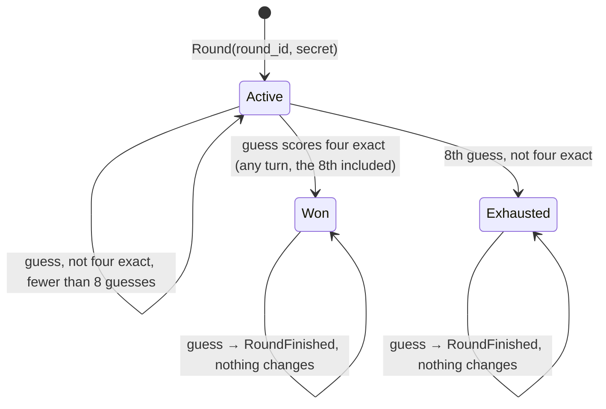
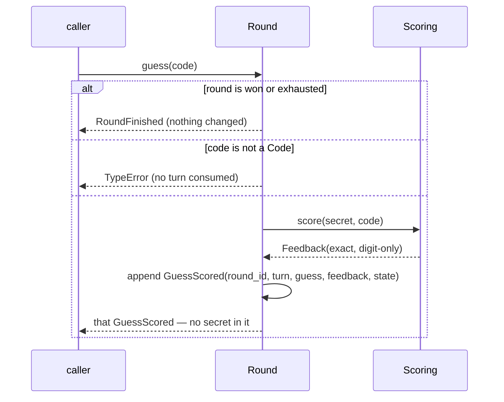
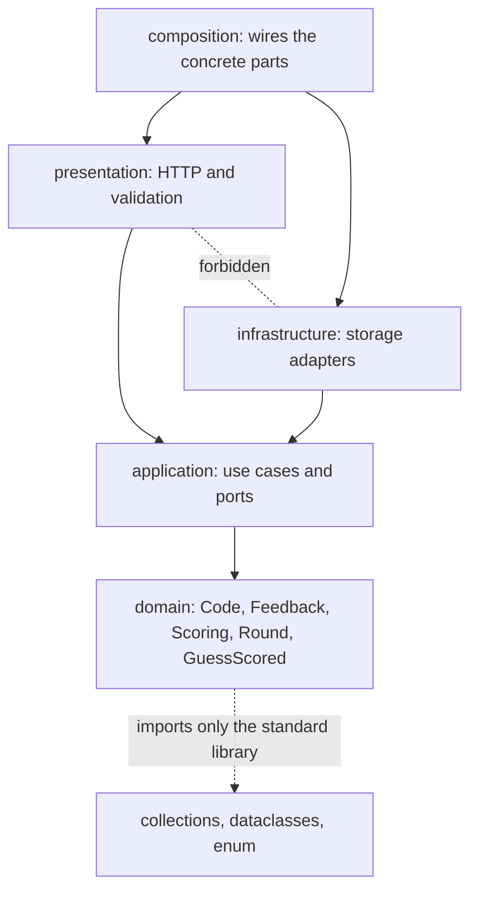

# 2. The round, its event, and where the rules live

How a game proceeds and ends, what the player is told, and why the rules do not depend on the web framework. Measured numbers are quoted by their id in [figures/values.md](figures/values.md).

[Back to the index](README.md)

## S06 — The round: eight guesses and three states

**Statement.** A round is active, won or exhausted, and the state is a function of its history alone:

- **won** when the last guess scored four exact — including the eighth guess;
- otherwise **exhausted** when eight guesses have been made;
- otherwise **active**.

A won or exhausted round rejects every further guess and does not change.

**Assumptions and where they break.** The check for a win comes before the check for exhaustion; the other order would turn a correct eighth guess into a loss. The history is append-only.

**Derivation.** A design rule. Because the state is derived rather than stored, it cannot disagree with the history.

**Code.** `Round.state`, `Round.guess`, `Round.turns_used`, `Round.turns_left` in `src/cipher_vault/domain/model.py`.

**Tests.** `test_REQ_ROUND_a_correct_eighth_guess_wins`, `test_REQ_ROUND_an_incorrect_eighth_guess_exhausts`, `test_REQ_ROUND_terminal_rounds_reject_and_do_not_change` (the round equals a deep copy taken before the rejected guess). Measured: `round-eighth-wins` = 1, `round-eighth-exhausts` = 1, `round-terminal-refuses` = 1, `round-terminal-history` = 8.

## S07 — One guess: validate, score, record

**Statement.** `guess(code)` does, in this order: refuse if the round is over; refuse if the argument is not a Code; score it against the secret (S03); build a `GuessScored` with the turn number and the state after this guess; append it to the history; return it. A refused call changes nothing — in particular **invalid input consumes no turn**.

The event carries the round's identity, the turn, the guess, the feedback and the state. It **never carries the secret**: what the player is shown can be built from events alone without revealing it.

**Assumptions and where they break.** The secret is on the `Round` object itself; keeping it out of responses while a round is active is the job of the layer that answers the player (M3 and M4), which should hand out events, not rounds.

**Derivation.** A design rule: every check happens before the first change, so there is no half-applied guess to undo.

**Code.** `Round.guess` and the dataclass `GuessScored` in `src/cipher_vault/domain/model.py`.

**Tests.** `test_REQ_ROUND_invalid_input_consumes_no_turn` (four kinds of non-code), `test_REQ_ROUND_a_correct_guess_wins_and_the_event_hides_the_secret`, `test_REQ_ROUND_identity_and_secret_are_required`. Measured: `round-invalid-free` = 0 turns used after a guess that is not a Code; `event-fields` = 5 and `event-secret-fields` = 0.

## S08 — The rules do not know about the web

**Statement.** The code is in four layers, and imports point inward only:

$$\text{composition} \;\to\; \{\text{presentation},\ \text{infrastructure}\} \;\to\; \text{application} \;\to\; \text{domain} .$$

Presentation and infrastructure do not import each other. The domain and the application import none of FastAPI, Pydantic and Uvicorn; the domain uses the standard library only.

**Assumptions and where they break.** The rule is about import statements. A dynamic import inside the core would slip past the static check — the second test below, which imports the core with third-party packages unavailable, covers that case for the packages that are not installed in the standard library.

**Derivation.** If the rules import nothing from the outer layers, they can be run, tested and reasoned about without a server or a database — every number in this handbook was produced that way — and the web framework or the storage can be replaced without touching them [Evans 2003, ch. 4; Martin 2017, ch. 22].

**Code.** The two Import Linter contracts in `pyproject.toml` (`Adapters point inward and remain independent`, and the forbidden-modules contract for the core); the package `src/cipher_vault/domain/__init__.py` exports the nine names of S01.

**Tests.** `make check` runs Import Linter (2 contracts kept); `test_REQ_CORE_imports_without_site_packages` in `tests/test_scaffold.py` starts Python with site packages disabled and imports the domain and the application.

## References

- E. Evans, *Domain-Driven Design*, Addison-Wesley, 2003.
- R. C. Martin, *Clean Architecture*, Prentice Hall, 2017.
