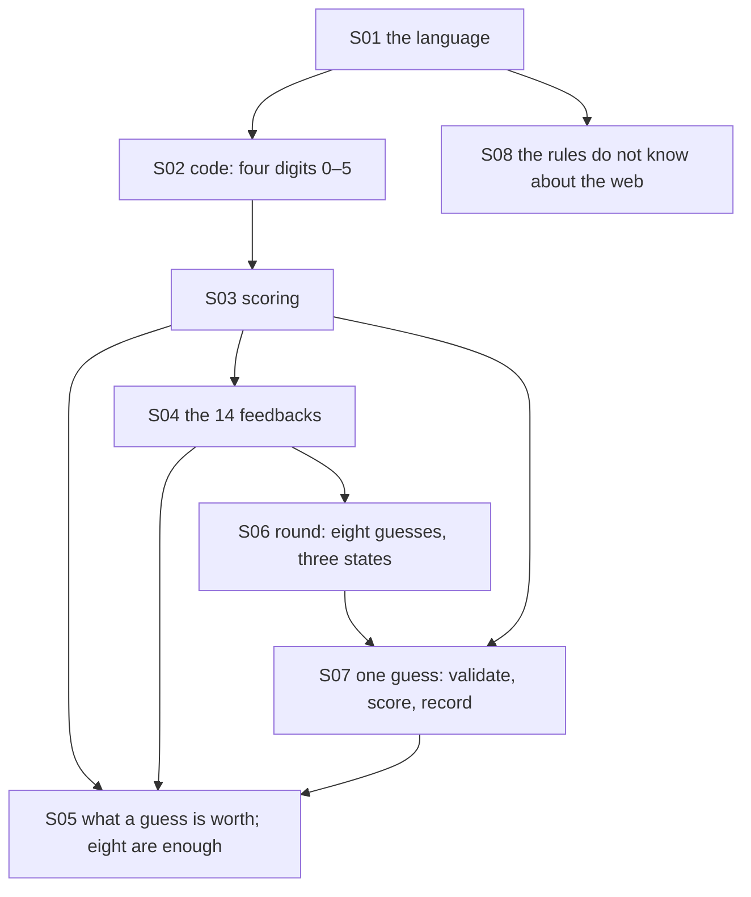

# Theory handbook

Why the program is correct, from the repository alone: every rule and invariant the code relies on, each stated in Markdown **with a figure**, the place in the code that implements it, and the test or measurement that checks it.

- Plotted figures and the numbers quoted in the text are produced by the domain itself: `make theory-figs` rewrites [figures/](figures/) and [figures/values.md](figures/values.md) (about 17 s; it scores all 1 679 616 pairs of codes and plays all 1296 rounds). Diagrams are Mermaid, written in the pages.
- `make theory-check` fails when a statement has no figure, a link is broken, a referenced function, test or measured value no longer exists, or a name exported by the domain is missing from the table below.

## Pages

1. [The rules: codes, feedback and what a guess tells you](01-rules.md) — the language, the code value, scoring, the possible feedbacks, why eight guesses are enough
2. [The round, its event, and where the rules live](02-round-and-layers.md) — the three states, one guess step by step, the dependency rule

## How the pieces depend on each other

## Coverage: statement → page → figure → code → test

| ID | Statement | Page | Figure | Code | Test |
|---|---|---|---|---|---|
| S01 | The language: Code, Guess, Feedback, Round, GuessScored, Scoring | [1](01-rules.md) | mermaid | `src/cipher_vault/domain/model.py#Code`, `src/cipher_vault/domain/model.py#Feedback`, `src/cipher_vault/domain/model.py#Scoring`, `src/cipher_vault/domain/model.py#GuessScored`, `src/cipher_vault/domain/model.py#Round`, `src/cipher_vault/domain/model.py#RoundState`, `src/cipher_vault/domain/model.py#RoundFinished` | `tests/test_domain.py#test_REQ_ROUND_a_correct_guess_wins_and_the_event_hides_the_secret` |
| S02 | A code is four digits from 0 to 5; 1296 codes | [1](01-rules.md) | mermaid | `src/cipher_vault/domain/model.py#CODE_LENGTH`, `src/cipher_vault/domain/model.py#parse` | `tests/test_domain.py#test_REQ_CODE_four_digits_from_zero_to_five`, `tests/test_domain.py#test_REQ_CODE_text_must_be_four_plain_digits` |
| S03 | Scoring: exact first, then the rest without reuse | [1](01-rules.md) | mermaid | `src/cipher_vault/domain/model.py#def score` | `tests/test_domain.py#test_REQ_SCORE_exact_first_then_the_rest_without_reuse`, `tests/test_domain.py#test_REQ_SCORE_every_pair_agrees_with_an_independent_count` |
| S04 | The 14 possible feedbacks; (3, 1) is impossible | [1](01-rules.md) | `figures/split.svg` | `src/cipher_vault/domain/model.py#def solved` | `tests/test_domain.py#test_REQ_CODE_feedback_values_are_possible_counts` |
| S05 | A guess splits the candidates; every round can be won in eight | [1](01-rules.md) | `figures/turns.svg`, `figures/minimax.svg` | `src/cipher_vault/domain/model.py#def guess` | `scripts/theory_figs.py#minimax-worst`, `scripts/theory_figs.py#first-fit-lost` |
| S06 | The round: eight guesses, three states | [2](02-round-and-layers.md) | mermaid | `src/cipher_vault/domain/model.py#MAX_GUESSES`, `src/cipher_vault/domain/model.py#def state` | `tests/test_domain.py#test_REQ_ROUND_a_correct_eighth_guess_wins`, `tests/test_domain.py#test_REQ_ROUND_terminal_rounds_reject_and_do_not_change` |
| S07 | One guess: validate, score, record; the event hides the secret | [2](02-round-and-layers.md) | mermaid | `src/cipher_vault/domain/model.py#def guess` | `tests/test_domain.py#test_REQ_ROUND_invalid_input_consumes_no_turn` |
| S08 | Layers and the inward dependency rule | [2](02-round-and-layers.md) | mermaid | `pyproject.toml#Adapters point inward and remain independent` | `tests/test_scaffold.py#test_REQ_CORE_imports_without_site_packages` |

Tests named `scripts/theory_figs.py#…` are measurements recorded in [figures/values.md](figures/values.md) by `make theory-figs`, not assertions of `make check`. S05 is covered only that way: it is a property of the rules, computed by playing every round, not a behaviour of one function.

What the measurements made visible: the obvious strategy — guess the first code that is still possible — does **not** always win within eight guesses (6 of 1296 secrets are missed), while a strategy that looks at how a guess splits the candidates never needs more than six. The limit of eight leaves room for imperfect play without making the game trivial.

## Reading the source against this table

Reviewed for this handbook: all of `src/cipher_vault/domain/model.py` (the nine names exported by `src/cipher_vault/domain/__init__.py`), the two Import Linter contracts in `pyproject.toml`, and `tests/test_domain.py`. The application, infrastructure and presentation packages hold no rules yet (M3, M4).

The program is unchanged by this handbook: it adds `scripts/theory_figs.py`, `scripts/theory_check.py`, two Makefile targets, one Ruff per-file setting and these pages.
